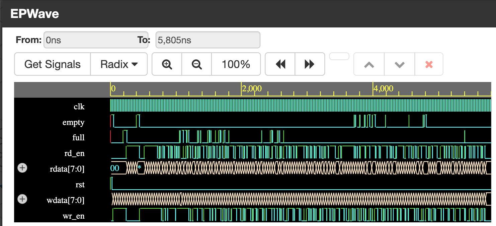

# Synchronous FIFO Verification: Layered SystemVerilog + UVM 1.2

Two independent verification environments for the same synchronous FIFO RTL: a hand-built **layered SystemVerilog testbench**, and a **UVM 1.2 testbench** with constrained-random sequences, a reference-model scoreboard, functional coverage and SVA-free flag checking. The UVM environment was validated by **injecting three RTL bugs, all of which it caught**.

| | Layered SV TB | UVM 1.2 TB |
|---|---|---|
| Location | `tb/layered/` | `tb/uvm/` |
| Stimulus | generator, mailboxes | sequences + sequencer |
| Checking | reference model + scoreboard | queue-based scoreboard (cycle-accurate for registered `rdata`) |
| Coverage | none | covergroup with wr x rd, wr x full, rd x empty crosses |
| Bug-injection validated | n/a | yes, 3 of 3 detected |

## Design Under Test

`rtl/design.sv`, module `fifo_dut`:

- Parameters: `WIDTH = 8`, `DEPTH = 16`
- Asynchronous, active-high reset
- Occupancy `count` register drives the `full` and `empty` flags
- **Registered read data:** `rdata` updates one clock *after* an accepted read (this is why the scoreboard compares one cycle late)
- Write ignored when full, read ignored when empty

| Signal | Direction | Description |
|---|---|---|
| `clk` | in | shared clock |
| `rst` | in | async reset, active high |
| `wr_en` | in | write enable |
| `rd_en` | in | read enable |
| `wdata[7:0]` | in | write data |
| `rdata[7:0]` | out | read data (registered) |
| `full` | out | FIFO full |
| `empty` | out | FIFO empty |

## Repository Structure

```
rtl/
  design.sv                      FIFO RTL (fifo_dut) + simple interface
tb/
  layered/                       Layered SystemVerilog testbench
  uvm/                           UVM 1.2 testbench
    fifo_uvm_if.sv               interface + clocking blocks
    fifo_item.sv                 sequence item
    fifo_seq_lib.sv              write / read / simultaneous / random sequences
    fifo_driver.sv  fifo_monitor.sv  fifo_agent.sv
    fifo_scoreboard.sv           reference model + data and flag checks
    fifo_coverage.sv             functional coverage
    fifo_env.sv  fifo_test.sv  fifo_pkg.sv  tb_top.sv
    eda_playground_testbench.sv  single-file build for EDA Playground
result/                          waveforms and bug-injection results
```

## Layered Testbench (`tb/layered`)

Generator, driver, monitor, reference model and scoreboard, connected by mailboxes. The generator constrains stimulus so write and read are never asserted together.

## UVM Testbench (`tb/uvm`)

### Architecture

```
                 fifo_base_test
                       |
                   fifo_env
        +--------------+----------------+
        |              |                |
    fifo_agent   fifo_scoreboard   fifo_coverage
   +----+-----+          ^                ^
   |    |     |          |  analysis      |
 sqr  driver monitor ----+--port----------+
        |       ^
        v       |
     fifo_uvm_if (clocking blocks) <--> fifo_dut
```

### Components

| Component | What it does |
|---|---|
| `fifo_uvm_if` | Interface with separate driver and monitor clocking blocks (race-free sampling) |
| `fifo_item` | Sequence item: `wr_en`, `rd_en`, `wdata`, plus sampled `rdata`, `full`, `empty`, `rst` |
| Sequences | Write-only, read-only, **simultaneous write+read**, fully random |
| `fifo_driver` | Waits for reset release, drives one item per clock, **drives idle when no item is pending** |
| `fifo_monitor` | Samples every clock through the monitor clocking block and publishes on an analysis port |
| `fifo_scoreboard` | SystemVerilog-queue reference model. Checks read data one cycle later (matches the registered `rdata`), checks `full`/`empty` against model occupancy every cycle, flushes on reset |
| `fifo_coverage` | `wr_en x rd_en`, `wr_en x full` (write attempted while full), `rd_en x empty` (read attempted while empty) |

### Test scenario (`fifo_base_test`)

1. 20 writes: fill all 16 entries, then 4 overflow writes
2. 20 reads: drain, then 4 underflow reads
3. 8 writes: half fill
4. 20 simultaneous write+read cycles
5. 500 constrained-random cycles

## Results

### Clean RTL
`UVM_ERROR: 0`, `UVM_FATAL: 0`. The test finishes at 5,805 ns.



### Bug injection
To check that the testbench detects failures, three bugs were injected into the RTL, one at a time:

| Bug | RTL change | UVM_ERROR count | Waveform |
|---|---|---|---|
| A | `full` asserts at `DEPTH-1` instead of `DEPTH` | 43 | [bug_A](result/bug_A.png) |
| B | read pointer never increments | 327 | [bug_B](result/bug_B.png) |
| C | writes accepted while FIFO is full | 334 | [bug_C](result/bug_C.png) |

All three were detected by the scoreboard, with flag and read-data mismatches reported. Details are in [`result/uvm_bug_injection.md`](result/uvm_bug_injection.md).

## Skills Demonstrated

SystemVerilog, UVM 1.2 (agent, sequences, factory, config_db, TLM analysis ports, phases and objections), simulator **Synopsys VCS**, clocking blocks, constrained-random verification, reference-model scoreboarding, functional coverage, mutation-style bug injection.narios  
5. **Environment** – Top-level integration of testbench layers
